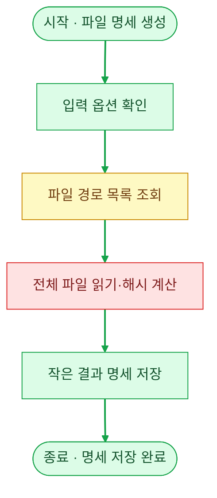
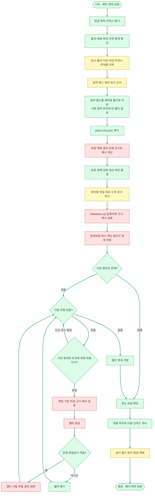
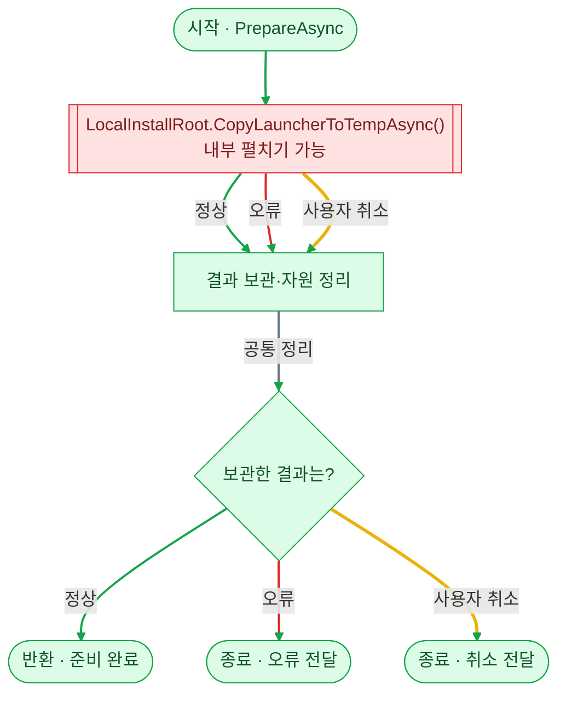
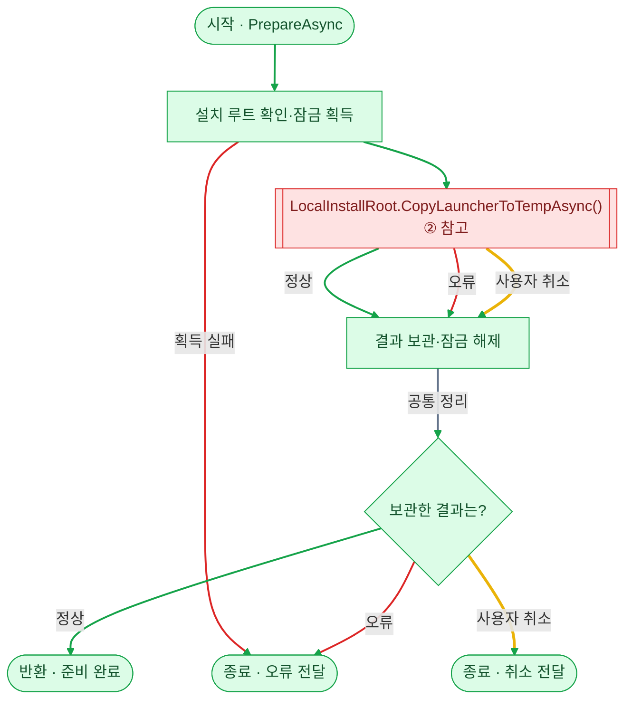
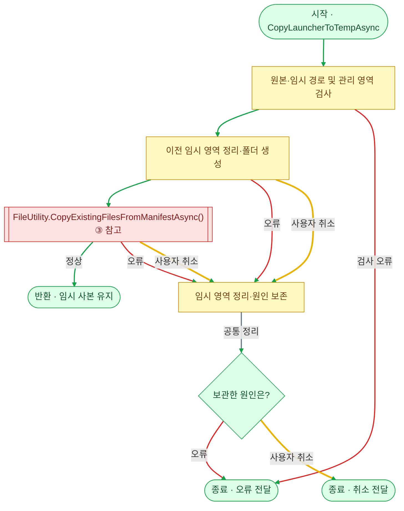
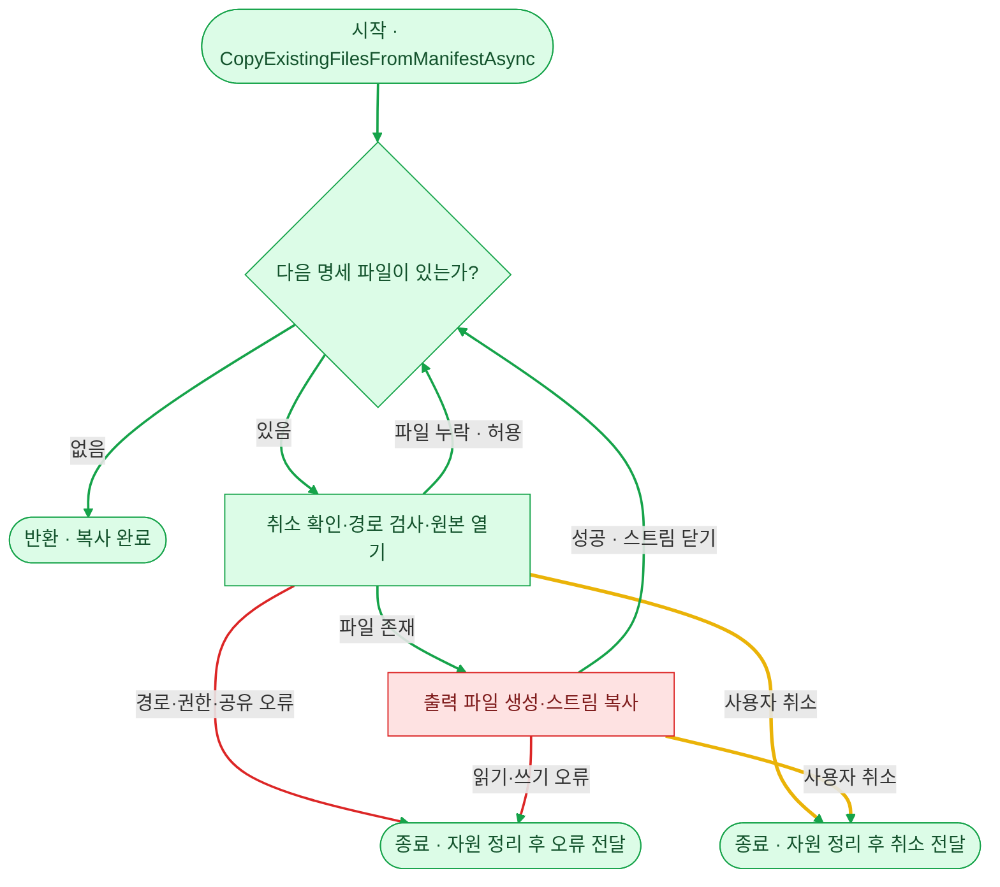
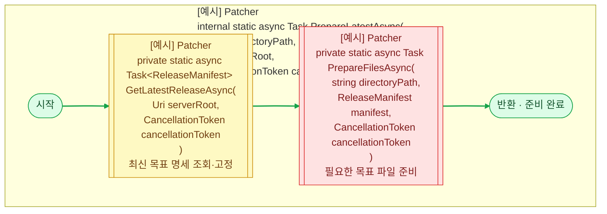
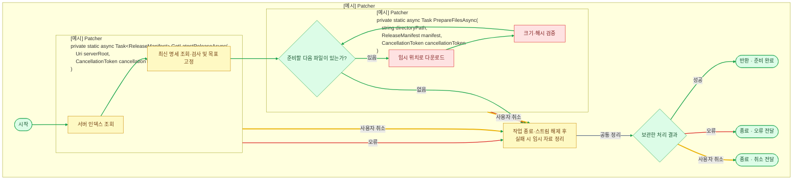

# 순서도 예시

Mermaid 코드 블록은 렌더링 가능한 원문이다. 처리시간은 측정값이 아닌 상대 추정이다.

## 1. 기본 예시
많은 파일의 경로를 조회하고 전체 내용을 읽어 해시를 계산한 뒤 작은 명세를 저장하는 흐름이다. 저=초록 · 중=노랑 · 고=빨강.

## 2. 실전 예시 — 패치 제작
전제: 작업 공간은 공통 잠금을 따르는 패처만 수정한다. 입력 빌드는 같은 볼륨의 제작용 폴더로 이동하며 실패해도 복원하지 않는다. 압축 중 검증하므로 게시 직전 전체 재검증은 하지 않는다. 이 전제를 다른 구현에 자동 적용하지 않는다.

저=초록 · 중=노랑 · 고=빨강. 델타(delta)는 이전 파일을 새 파일로 바꾸는 차이 데이터다.

- 해시 알고리즘이 바뀌면 보존 정책·델타 대상 판단에도 이전 파일 읽기가 추가된다.
- 이동 후 게시 전 실패·취소 시 복원하지 않고 잔여물을 남기며 잠금은 해제한다. 다음 작업은 정해진 미게시 잔여물만 정리한다.
- 게시 확정 구간부터는 취소하지 않는다. 게시 후 정리 실패는 게시 성공과 구분해 경고한다.

## 3. 단일 순서도 — 펼칠 수 있는 호출 강조

아래와 다음 다중 예시는 설명용 가상 코드다. 특정 프로젝트의 구현 완료를 뜻하지 않는다. PrepareAsync는 CopyLauncherToTempAsync를 호출하고 실패/취소 시 자원을 정리한다. 노드 색은 상대 비용, 선 색은 정상 초록·오류 빨강·사용자 취소 노랑·공통 정리 회색이다.

## 4. 다중 순서도 — 함수별 책임 분리

“멀티 순서도로 보여줘” 요청이면 다음처럼 펼친다. 경로 프로퍼티와 단순 위임 함수는 추가 그림으로 만들지 않는다. 아래는 복사 책임을 설명하는 예시이며 병렬 처리를 가정하지 않는다. 실제 코드가 병렬이면 작업자 수와 전체 종료 대기를 별도로 반영한다.

### ① Launcher.cs · PrepareAsync

자원/잠금은 상위 함수가 관리한다. 자식 ②·③에서는 다시 획득하지 않는다. 간결하게 표현하기 위해 획득 실패는 종료 예외로 바로 전달하며, 획득하지 못한 자원은 해제하지 않는다.

### ② LocalInstallRoot.cs · CopyLauncherToTempAsync

전제: ①이 설치 루트 잠금을 보유한다. 임시 영역은 이 함수가 관리하며 파일 순회는 ③에 위임한다. 실패 정리 중 오류가 나도 원래 오류·취소 원인을 유지한다.

### ③ FileUtility.cs · CopyExistingFilesFromManifestAsync

전제: ②가 목적지와 명세를 준비했다. 누락은 정상 건너뛰기이며 접근 오류를 누락으로 취급하지 않는다. 출력 파일 삭제는 ②의 책임이고 이 함수는 열린 스트림을 정리한 후 반환/예외를 전달한다.

③의 반환·오류·취소는 ②의 호출 노드 출력과, ②의 출력은 ①의 호출 노드 출력과 대응한다. 부모 그림에 자식의 파일 순회나 복사 로직을 다시 펼치지 않는다.

## 5. 전체 선언부와 파라미터 개행 — 큰 덩어리

아래는 표현용 가상 선언이다. 실제 프로젝트의 구현이나 확정된 함수 구성을 뜻하지 않는다. 전체 함수를 바깥 영역으로 감싸고, 보조 호출은 이중선 노드로 표시한다. 파라미터는 한 줄에 하나씩, 닫는 괄호는 별도 줄로 표시한다. 접근 제한자를 쓰므로 접근 기호는 중복하지 않는다. 정상 흐름만 보여주며 오류·취소는 생략했다.

## 6. 바깥 함수 영역 안에 여러 내부 함수 영역

예시 5의 두 호출을 영역으로 펼친다. 선언부만을 위한 실행 노드는 만들지 않는다. 전체 함수 선언은 바깥 영역 제목에, 보조 함수 선언은 내부 영역 제목에 표시한다. `title`의 줄바꿈에 의존하지 않고 ` `를 사용한다.

설명용 순차 파일 준비이며 보존·델타 정책은 생략했다. 파일 교체·설치 기록 저장도 범위 밖이다. 정상은 초록, 오류는 빨강, 사용자 취소는 노랑, 공통 정리는 회색 선이다. 영역에서 정리로 향하는 선은 해당 함수 전체에 적용된다.

함수 영역은 중립적인 외곽선으로 두고 내부 노드에만 비용색을 적용한다. 바깥 함수 영역을 포함한 두 단계 구조는 선언부의 개행과 함수 소속을 표현하기 위한 것이며 임의의 제품 함수 분리를 의미하지 않는다.
