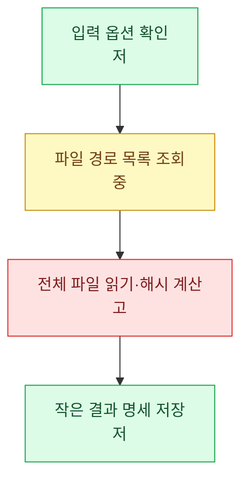
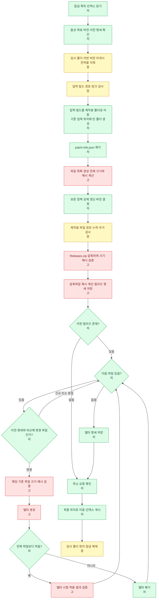

# 순서도 예시 두 가지

Mermaid 코드 블록은 렌더링 가능한 원문이다. 처리시간은 측정값이 아닌 상대 추정이다.

## 1. 기본 예시
많은 파일의 경로를 조회하고 전체 내용을 읽어 해시를 계산한 뒤 작은 명세를 저장하는 흐름이다. 저=초록 · 중=노랑 · 고=빨강.

## 2. 실전 예시 — 패치 제작
전제: 작업 공간은 공통 잠금을 따르는 패처만 수정한다. 입력 빌드는 같은 볼륨의 제작용 폴더로 이동하며 실패해도 복원하지 않는다. 압축 중 검증하므로 게시 직전 전체 재검증은 하지 않는다. 이 전제를 다른 구현에 자동 적용하지 않는다.

저=초록 · 중=노랑 · 고=빨강. 델타(delta)는 이전 파일을 새 파일로 바꾸는 차이 데이터다.

- 해시 알고리즘이 바뀌면 보존 정책·델타 대상 판단에도 이전 파일 읽기가 추가된다.
- 이동 후 게시 전 실패·취소 시 복원하지 않고 잔여물을 남기며 잠금은 해제한다. 다음 작업은 정해진 미게시 잔여물만 정리한다.
- 게시 확정 구간부터는 취소하지 않는다. 게시 후 정리 실패는 게시 성공과 구분해 경고한다.