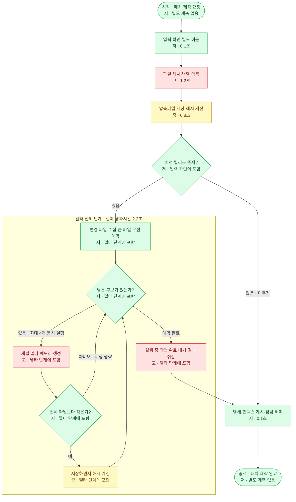

# 측정 포함 순서도

## 실행 범위와 입력
- 실제 실행할 함수·명령, 입력, 작업 위치와 실행 환경을 확인한다. 기존에 합의한 테스트 입력과 artifacts 위치가 있으면 재사용한다.
- 입력을 소비하거나 변경하는 알고리즘은 원본 대신 테스트 사본을 사용하고, 반복마다 동등한 초기 상태를 준비한다. 비용과 부작용을 확인하기 전에는 여러 번 실행하지 않는다.
- 측정 요청만으로 실제 배포·원본 삭제·외부 서비스 변경을 실행하지 않는다. 필요한 대상이나 권한이 없으면 그 부분을 질문하고, 실행할 수 없는 분기는 미측정으로 남긴다.
- 목적은 관찰이다. 측정을 위해 제품 알고리즘이나 기본 설정을 최적화하지 않는다.

## 측정점과 반복
- 주요 단계 경계에 단조 증가 타이머(예: Stopwatch)를 사용한다. 기존 진단 기능, 테스트용 실행 프로그램 또는 소스 사본을 우선하며 제품 코드에 측정 코드를 영구 추가하지 않는다.
- 소스 사본에는 측정점만 추가한다. 알고리즘·컴파일 구성·의존성·병렬도 차이가 있으면 기록한다. 타이머나 로그 비용이 결과를 지배하지 않도록 작은 연산마다 측정하지 않는다.
- 비동기 호출은 완료까지 기다려 측정한다. 예약 시간만 실행시간으로 표시하지 않는다. 병렬 단계는 실행 중인 모든 작업이 끝나는 경계까지 포함한다.
- 입력 복사·초기화·빌드·결과 검증을 알고리즘 시간에서 분리한다. 프로세스 시작·종료와 파일 저장 완료 대기 포함 여부도 기록한다.
- 기본 3회 측정하되 장시간 작업이나 부작용이 크면 횟수를 조정하고 이유를 설명한다. 캐시가 데워진 조건인지, 첫 실행인지, 준비 작업이 캐시에 영향을 주는지 기록한다. 비교 실험은 서로 동시에 실행하지 않는다.
- 전체 실행시간의 중앙값에 해당하는 실제 회차를 대표 순서도에 사용한다. 짝수 회차라면 수치 중앙값과 가장 가까운 실제 회차를 선택하고 선택 기준을 밝힌다. 단계별 중앙값을 조합한 가상 회차를 만들지 않는다.

## 시간 해석과 표현
- 각 단계에 실행시간을 넣고, 필요할 때 같은 회차의 전체 시간 대비 비중을 표시한다. 짧은 구간은 ms, 긴 구간은 초로 표시하며 자릿수를 과도하게 늘리지 않는다.
- 저·중·고 색상은 상대 비용, 숫자는 실측임을 설명한다. 실행하지 않은 분기는 `미측정`, 따로 계측하지 않은 판단은 `상위 단계에 포함`으로 표시한다. 빈 값에 0초를 넣지 않는다.
- 반복 단계는 파일 한 개의 시간인지 전체 반복 누적인지 명시한다.
- 병렬 단계는 Elapsed time(실제 경과시간)을 쓴다. 작업별 소요시간은 서로 겹치므로 더해서 단계 시간으로 쓰거나 전체 경과시간에서 빼서 나머지 비용을 계산하지 않는다. 필요하면 별도 누적 통계라고 표시한다.
- 부모 구간과 그 내부 구간을 중복 합산하지 않는다. 작업 예약·합류·저장 등을 묶어 측정했다면 포함 범위를 표시한다. 병렬 스케줄링은 순서도에서도 동시 실행 수와 전체 완료 대기가 드러나게 한다.
- 처리량·속도 향상률은 비교 대상과 측정 조건이 확인된 경우에만 제시한다. 이전 기록은 현재 코드의 측정값으로 바꾸어 말하지 않는다.

## 기록과 완료 보고
- artifacts 등 합의된 위치에 원시 측정 결과, 순서도 원문과 짧은 보고서를 저장한다. 특정 디렉터리가 프로젝트에 없으면 적절한 위치를 선택하고 밝힌다.
- 원시 기록에는 회차별 전체·단계 시간, 코드 커밋과 미커밋 변경 여부, 입력 식별 정보·규모, 실행 구성·런타임·장비·병렬도, 측정 범위를 남긴다. 공개 저장소에는 개인 경로·입력 데이터·원시 로그를 임의로 추가하지 않는다.
- 성공·실패 여부와 결과 확인 범위를 기록한다. 추가 결과 검증은 사용자·프로젝트 지침을 따르며, 시간만 측정했다면 기능 정확성까지 검증했다고 말하지 않는다.
- 완료 답변에는 측정 조건·대표 회차·색상 범례를 짧게 설명하고 순서도를 직접 표시한다. 보고서 링크만 주고 순서도를 생략하지 않는다. 반복 편차, 미측정 분기, 검증 수행·생략 여부와 변경 파일도 알린다.

## 예시 3 — 측정한 병렬 패치 제작

다음은 표현을 위한 가상 측정 기록이다. 실제 프로젝트의 실측값으로 인용하지 않는다. 세 회차 총시간이 4.2초, 4.4초, 4.8초라면 중앙값 회차인 2회차의 단계 기록만 사용한다. 저=초록, 중=노랑, 고=빨강. 델타(delta)는 이전 파일을 새 파일로 바꾸는 차이 데이터다.

델타 내부 노드 각각에 2.2초를 부여하지 않는다. 반복 화살표는 다음 후보 처리를 뜻하며, 여러 작업자는 동시에 실행된다. 예시의 정상 흐름 합계는 4.4초다. 실패·취소 경로는 이 가상 기록에서 미측정이며, 실제 코드에 맞춰 별도로 설명한다.
